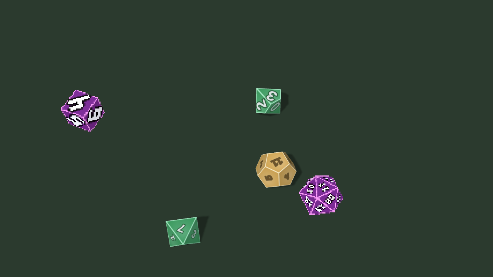
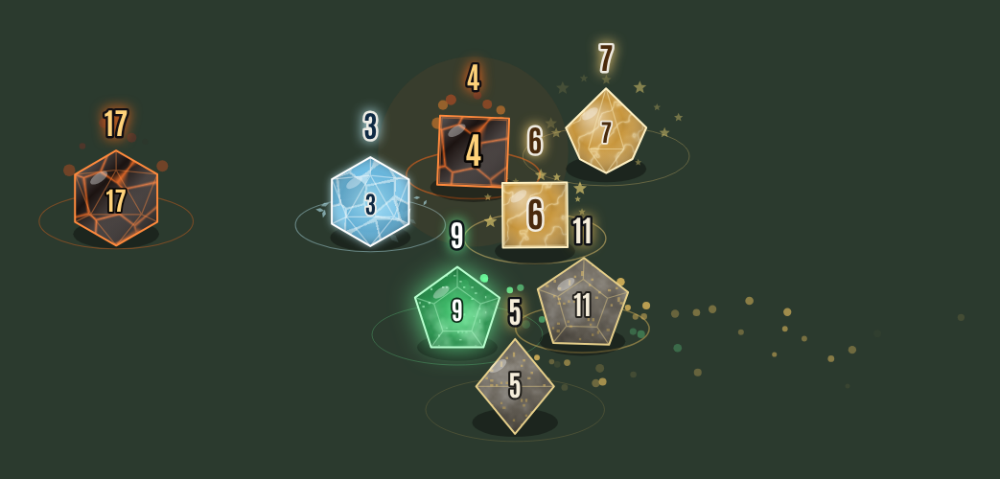
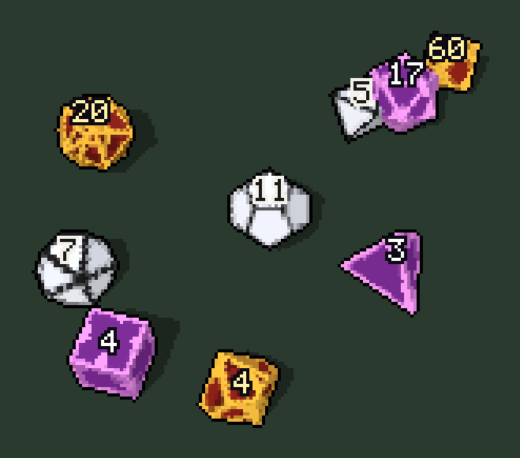
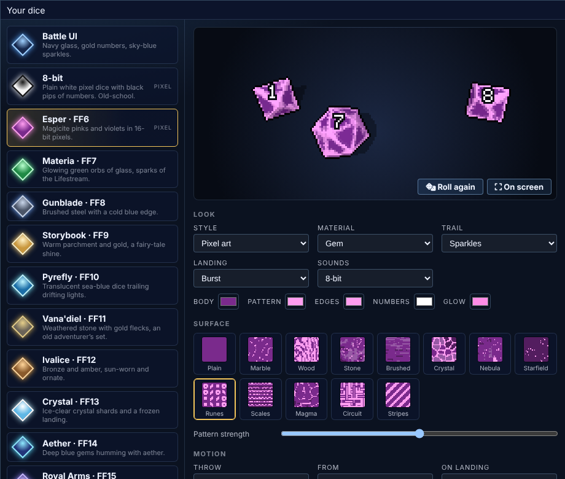

# Fabula Ultima Dice

JRPG dice for Foundry VTT v13. Every roll posted to chat is thrown across the screen as real 3D dice: they tumble, bounce off each other and roll to a stop with the result on top, leaving a trail and a landing effect. Pixel-art or smooth, and every player picks their own.

| | |
|---|---|
|  |  |
| The lighter 2D dice, with a Project FU critical | 2D pixel dice next to smooth ones |

## Install
In Foundry: **Add-on Modules → Install Module**, paste this Manifest URL and click Install:
`https://github.com/EclipseGS27/fu-dice/releases/latest/download/module.json`

Then enable **Fabula Ultima Dice** in your world. It works with any system; with Project FU, criticals and fumbles get their own flourish. It needs no other module and no downloads: the dice, effects and sounds are all drawn and synthesized in code.

## Your dice
Settings → **Choose your dice** opens a window with every preset on the left and a live preview on the right. Pick a preset, then change any part of it; **Roll again** replays the preview, **On screen** throws them across your screen. Save, and everyone sees your rolls in your dice.

- **Style**: pixel art (chunky, hard-edged, a bitmap font) or smooth (anti-aliased, with gradients and glow).
- **Material**: gem, glass, metal or flat.
- **Colors**: body, edges, numbers and glow.
- **Trail**: sparkles, stars, flames, embers, ice shards, floating motes, feathers, crystal shards or none.
- **Landing**: a ring, a burst, a flash or nothing.
- **Sounds**: chimes, crystal, wooden clack, 8-bit or silent.

### Presets
Battle UI (navy glass and gold, to match Fabula Ultima Battle UI), 8-bit, Ember pixel, and one for each Final Fantasy era from VI to XVI: Esper (VI), Materia (VII), Gunblade (VIII), Storybook (IX), Pyrefly (X), Ivalice (XII), Crystal (XIII), Aether (XIV), Royal Arms (XV) and Eikon (XVI). They take each era's mood and colors; nothing is copied from the games.

## How it plays
- **Real 3D dice**: d4, d6, d8, d10, d12 and d20 as true polyhedra (d100 as a tens and a units d10), thrown with real physics. Each throw is worked out the moment it starts, and the numbers are laid on the dice so the face that lands on top is the actual result: what you see always matches the chat card. Pixel dice are rendered at low resolution with banded shading and crisp bitmap numbers, so they look like sprites.
- **2D dice** (setting): flat dice that bounce and tumble on a 2D canvas, for older computers. Without WebGL the module uses them on its own.
- **Every roll in chat**: the dice of each roll fly in from the lower right and land in the middle of the screen. Big rolls show up to a set number of dice; the chat card still has every result.
- **The card waits**: a roll's chat card appears once its dice have landed, so the result isn't spoiled (setting; never more than a few seconds).
- **Each player's own dice**: rolls show in the dice their roller chose (setting: or always yours).
- **Rolls you may not see**: a blind or private roll you can't read still throws its dice, with "?" on them. Rolls whispered to others don't show.
- **Project FU**: a critical success flashes CRITICAL! with a burst of stars and a fanfare; a fumble shows FUMBLE.
- **Light on the computer**: one canvas that only draws while dice are moving and hides when they're gone; the physics of a throw is worked out once, up front. Lighter effects turns off trails, dust and landing effects; 2D dice are lighter still.
- **Dice So Nice**: when it is on, this module steps aside (world setting).

## Settings
Client (each player for themselves): 3D or 2D dice, show dice, whose rolls (everyone's, only mine, none), each player's own dice, wait for the dice, dice size, dice speed, dice volume (times Foundry's interface volume), most dice per roll, lighter effects. World: step aside for Dice So Nice.

## For macros
`game.modules.get('fu-dice').api.roll([{ faces: 20, value: 17 }])` throws dice on your screen; `.test()` throws a demo pair; `.config()` opens the dice window.

## Credits
- 3D: three.js (MIT, © three.js authors) and cannon-es (MIT, © cannon.js authors), included in `lib/` with their licenses.
- Font: Antonio, SIL Open Font License (see `fonts/`).
